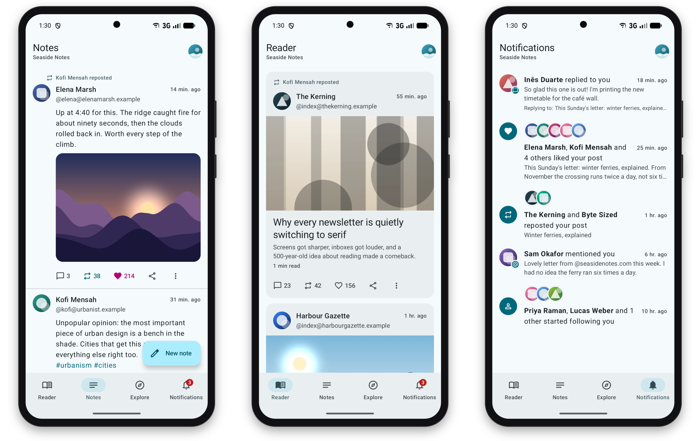

# Social Web for Ghost (Android)

A native Android app for the social web of your Ghost site. Ghost 6 connects every site to the fediverse through ActivityPub: people on Mastodon, WordPress, other Ghost sites and the rest of the open social web can follow you, and you can follow them. This app lets you read, post and reply from your phone.



It's the Android sibling of [Social Web for Ghost on iOS](https://www.synapsmedia.com/tools/social-web-ios/) by Murat Çorlu of Synaps Media. Murat has no Android phone and Jannis Fedoruk-Betschki of Magic Pages has no iPhone, so they split the platforms between them.

The app is built by [Magic Pages](https://www.magicpages.co). It's an independent app, not made by or affiliated with the Ghost Foundation. Ghost is a trademark of the Ghost Foundation.

## What it does

- **Notes:** short posts from everyone you follow. Like, repost, quote and reply. The feed remembers where you were and shows a "new posts" button instead of jumping, and a "You're all caught up" line marks where the posts you've already seen begin. Hide reposts or posts with muted words.
- **Reader:** long-form articles from the publications you follow, in a reading view with audio and video. Pick the page colour (auto, sepia, light or dark), a sans or serif typeface and the text size, as in Ghost Admin's reader.
- **Explore:** find people and publications, or browse topics like News or Photography as posts or as people to follow.
- **Posting:** notes and replies with photos and alt text, from your site's own profile. Take a photo with the camera right in the composer. GIFs from KLIPY when your Ghost site has a KLIPY key, like its editor's GIF card. Share a link, text or a photo from any other app to start one.
- **Your profile:** edit your name, username, bio, picture and cover image. Share any profile as a QR code, a link or a picture card.
- **Notifications:** likes, reposts, replies, mentions and new followers, grouped. The app checks for new ones in the background with WorkManager about every 15 minutes; there is no push server.
- **Translation** of notes and articles with ML Kit, on the device.
- **Bluesky:** share your site on Bluesky through Bridgy Fed, like Ghost's own setting. Choose whether media marked as sensitive shows without a tap.
- **Several sites** in one app, plus member sign-in to read a site's members-only posts.
- **Moderation:** block accounts or whole servers, report posts and people.
- **Large screens:** on tablets, foldables and in landscape, a thread or profile opens next to the list.

The interface is translated into 24 languages.

## Requirements

- Android 10 (API 29) or newer.
- A Ghost 6 site with the social web turned on, and an **Owner** or **Administrator** account on it. That's Ghost's rule for the social web; Editors, Authors and Contributors can't sign in.

You sign in to your own site with your email and password (plus the code Ghost emails you), or with a Staff Access Token. There's no new account to create.

## Install

The app is in testing on Google Play. To join, email [help@magicpages.co](mailto:help@magicpages.co) from the Google account on your phone and you'll get the opt-in link.

Or build it yourself, see below.

## Build

You need JDK 17 or newer and the Android SDK with platform 37. Android Studio brings both.

There are two flavors. `play` is the Google Play app: it translates with Google's ML Kit. `foss` is the F-Droid app, free software only: it identifies languages with Android's own text classifier and translates through the [Offline Translator](https://f-droid.org/packages/dev.davidv.translator/) app, which the user installs from F-Droid. Everything else is the same code.

```sh
./gradlew :app:assemblePlayDebug    # app/build/outputs/apk/play/debug/app-play-debug.apk
./gradlew :app:installPlayDebug     # build and install on the connected device
./gradlew :app:installFossDebug     # the F-Droid flavor
./gradlew :app:installPlayDev       # the store build's speed: R8, not debuggable, no demo mode
```

Debug and dev builds install as `co.magicpages.socialweb.debug`, "Social Web (dev)", next to the store app: Play signs the store app with its own key, so a local build can't replace it. Both use the debug key, so either installs over the other and keeps its sign-ins. Debug builds are much slower than the store app; try performance on a dev build.

Checks:

```sh
./gradlew :app:testPlayDebugUnitTest :app:testFossDebugUnitTest   # unit tests
./gradlew :app:lintPlayDebug :app:lintFossDebug                   # Android lint
```

A release bundle needs an upload key. [RELEASING.md](RELEASING.md) covers signing, versioning, the store listing and the baseline profile.

### Demo mode

The debug build has a demo mode that signs in to a made-up site, "Seaside Notes", and answers every request from built-in content. It needs no Ghost site and no network, never touches real accounts, and is how the screenshots are made.

```sh
adb shell am force-stop co.magicpages.socialweb.debug
adb shell am start -n co.magicpages.socialweb.debug/co.magicpages.socialweb.MainActivity --ez demo true
```

`--ez demo false` switches back. The release build doesn't contain demo mode.

## How it's put together

Kotlin, Jetpack Compose with Material 3, Navigation 3, Hilt, Ktor, kotlinx.serialization, Coil, Media3, Paging and WorkManager.

| Path | What's there |
|---|---|
| `app/src/main/kotlin/co/magicpages/socialweb/data/` | Clients for Ghost's social web API (`activitypub`), the Ghost Admin and members APIs (`ghost`, `member`), accounts, link previews, translation, settings |
| `app/src/main/kotlin/co/magicpages/socialweb/ui/` | One package per screen (`feed`, `thread`, `profile`, `notifications`, `article`, …) plus shared `components` and `theme` |
| `app/src/main/kotlin/co/magicpages/socialweb/background/` | Background notification checks and notification actions |
| `app/src/debug/` | Demo mode: made-up content and placeholder pictures |
| `app/src/play/`, `app/src/foss/` | The two translators: ML Kit for Play, Offline Translator for F-Droid (with its AIDL interface) |
| `app/src/test/` | Unit tests |
| `baselineprofile/` | Records the baseline profile by driving demo mode |
| `fastlane/metadata/android/` | Store listing text, icon, feature graphic and screenshots |

Your account data goes to your Ghost site only: the social web API under `/.ghost/activitypub/` and the Admin API, with your session. Besides that, the app loads pictures and media from where they're hosted, fetches the pages behind links to show previews, sends what you type in the GIF search to KLIPY with your site's KLIPY key, and (Play app only) downloads ML Kit's language models from Google the first time you translate into a language. The F-Droid app hands the text to Offline Translator on the device instead. Sign-in sessions and tokens are encrypted with Tink, using a key held in the Android Keystore, and are excluded from backups. There's no analytics, crash reporting service or tracking.

## Contributing

Bug reports and pull requests are welcome. For anything bigger than a fix, open an issue first so we can agree on the approach.

- Run the unit tests and lint before you open a pull request.
- New user-facing text goes into `app/src/main/res/values/strings.xml`. Translations of existing strings are welcome too, in the matching `values-*` folder.
- Keep it free of third-party services: no analytics, ads or tracking SDKs.

Found a security problem? Please don't open a public issue; see [SECURITY.md](SECURITY.md).

## License

[MIT](LICENSE) © Magic Pages and contributors.
